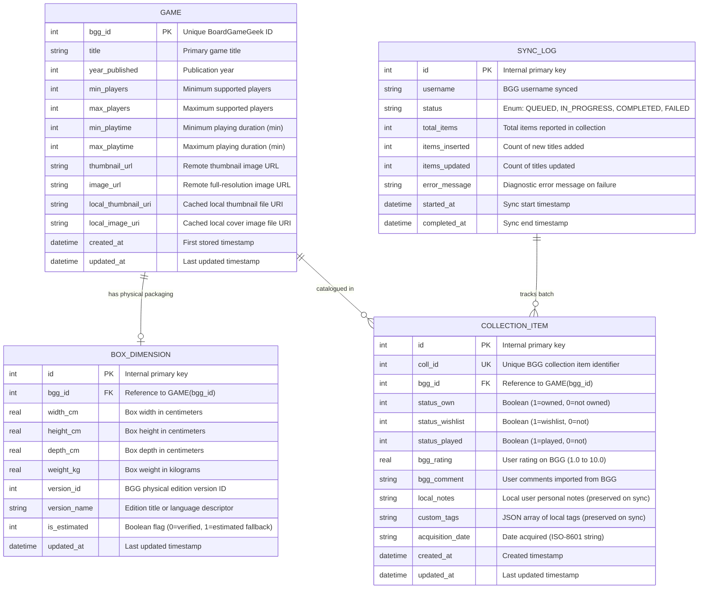
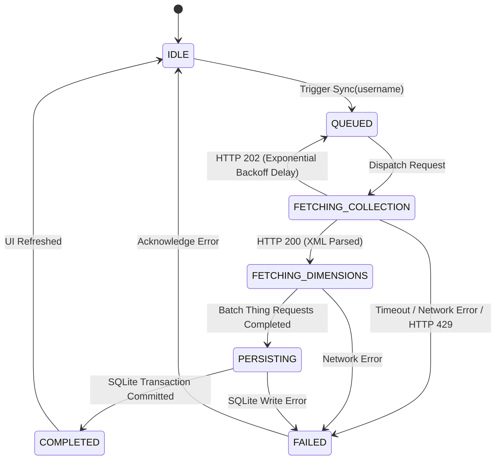

# Data Model: BGG Collection Sync & Local Storage

**Feature**: `001-bgg-collection-sync`  
**Date**: 2026-11-14  
**Status**: Completed  

---

## 1. Entity-Relationship Overview

---

## 2. Table Schemas & Validation Rules

### 2.1 `games` Table
Stores canonical board game information. Independent of individual user ownership.
- `bgg_id`: `INTEGER PRIMARY KEY NOT NULL`. Positive integer.
- `title`: `TEXT NOT NULL`. Non-empty string (trimmed, UTF-8).
- `year_published`: `INTEGER`. Valid range: $-3500$ to $2100$.
- `min_players`: `INTEGER`. Default: $1$, range $1 \le min\_players \le max\_players$.
- `max_players`: `INTEGER`. Range: $\ge min\_players$.
- `min_playtime`: `INTEGER`. Minimum minutes $\ge 0$.
- `max_playtime`: `INTEGER`. Maximum minutes $\ge 0$.
- `thumbnail_url`: `TEXT`. Valid HTTP/HTTPS URL or null.
- `image_url`: `TEXT`. Valid HTTP/HTTPS URL or null.
- `local_thumbnail_uri`: `TEXT`. Local filesystem file path or null.
- `local_image_uri`: `TEXT`. Local filesystem file path or null.
- `created_at`: `INTEGER NOT NULL`. Unix epoch timestamp in milliseconds.
- `updated_at`: `INTEGER NOT NULL`. Unix epoch timestamp in milliseconds.

### 2.2 `box_dimensions` Table
Stores physical dimensions necessary for procedural 3D box generation.
- `id`: `INTEGER PRIMARY KEY AUTOINCREMENT NOT NULL`.
- `bgg_id`: `INTEGER NOT NULL UNIQUE REFERENCES games(bgg_id) ON DELETE CASCADE`.
- `width_cm`: `REAL NOT NULL`. Positive float, range: $2.0 \le width \le 120.0$.
- `height_cm`: `REAL NOT NULL`. Positive float, range: $2.0 \le height \le 120.0$.
- `depth_cm`: `REAL NOT NULL`. Positive float, range: $0.5 \le depth \le 80.0$.
- `weight_kg`: `REAL`. Range: $\ge 0.0$ or null.
- `version_id`: `INTEGER`. Nullable BGG version ID.
- `version_name`: `TEXT`. Nullable descriptive string.
- `is_estimated`: `INTEGER NOT NULL DEFAULT 0`. Boolean (`1` if default fallback values used, `0` if verified from BGG version).
- `updated_at`: `INTEGER NOT NULL`. Unix epoch timestamp in milliseconds.

### 2.3 `collection_items` Table
Stores user ownership records, associating a game with ratings, comments, and local annotations.
- `id`: `INTEGER PRIMARY KEY AUTOINCREMENT NOT NULL`.
- `coll_id`: `INTEGER NOT NULL UNIQUE`. Unique identifier assigned by BGG to each collection entry.
- `bgg_id`: `INTEGER NOT NULL REFERENCES games(bgg_id) ON DELETE CASCADE`.
- `status_own`: `INTEGER NOT NULL DEFAULT 1`. Boolean ($0$ or $1$).
- `status_wishlist`: `INTEGER NOT NULL DEFAULT 0`. Boolean ($0$ or $1$).
- `status_played`: `INTEGER NOT NULL DEFAULT 0`. Boolean ($0$ or $1$).
- `bgg_rating`: `REAL`. User rating from BGG ($1.0 \le rating \le 10.0$) or null if unrated.
- `bgg_comment`: `TEXT`. User comment from BGG or null.
- `local_notes`: `TEXT`. Custom user notes maintained only on device (MUST NEVER be overwritten by sync).
- `custom_tags`: `TEXT`. JSON string array of user tags (MUST NEVER be overwritten by sync).
- `acquisition_date`: `TEXT`. Optional ISO-8601 date string.
- `created_at`: `INTEGER NOT NULL`. Unix epoch timestamp in milliseconds.
- `updated_at`: `INTEGER NOT NULL`. Unix epoch timestamp in milliseconds.

### 2.4 `sync_logs` Table
Audit log of all synchronization operations.
- `id`: `INTEGER PRIMARY KEY AUTOINCREMENT NOT NULL`.
- `username`: `TEXT NOT NULL`.
- `status`: `TEXT NOT NULL CHECK(status IN ('QUEUED', 'FETCHING_COLLECTION', 'FETCHING_DIMENSIONS', 'PERSISTING', 'COMPLETED', 'FAILED'))`.
- `total_items`: `INTEGER NOT NULL DEFAULT 0`.
- `items_inserted`: `INTEGER NOT NULL DEFAULT 0`.
- `items_updated`: `INTEGER NOT NULL DEFAULT 0`.
- `error_message`: `TEXT`. Diagnostic error string if failed.
- `started_at`: `INTEGER NOT NULL`. Unix epoch timestamp.
- `completed_at`: `INTEGER`. Unix epoch timestamp or null while in progress.

---

## 3. State Transitions for Synchronization

