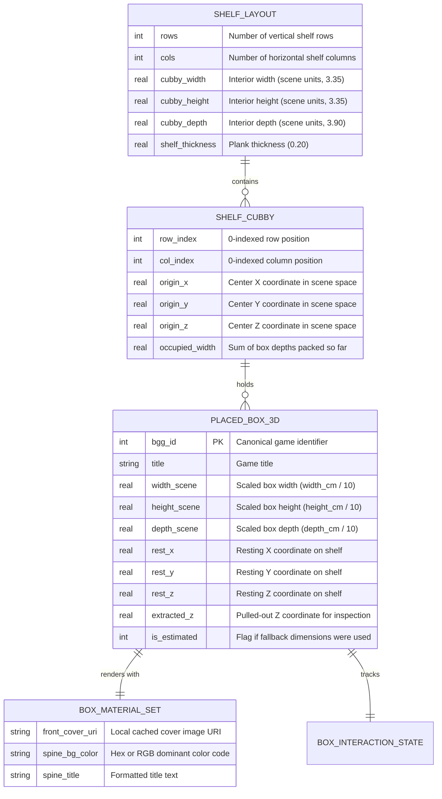
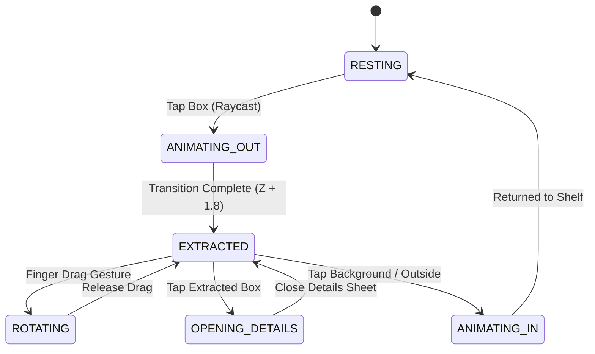

# Data Model: 3D Virtual Shelf Spatial Layout & Interaction

**Feature**: `002-3d-virtual-shelf`  
**Date**: 2026-11-14  
**Status**: Completed  

---

## 1. Spatial Entities & Data Flow

---

## 2. Spatial Types & Invariants

### 2.1 Coordinate Space Convention
- **Coordinate System**: Right-handed Cartesian coordinates:
  - $+X$: To the right across the shelf.
  - $+Y$: Upwards toward upper shelf rows.
  - $+Z$: Outwards toward the camera/user.
- **Scale Factor**: $1\text{ Scene Unit} = 10.0\text{ cm}$.
- **Origin `[0, 0, 0]`**: Center of the overall bookcase assembly.

### 2.2 Placement Packing Logic
For each game with dimensions $(w_{cm}, h_{cm}, d_{cm})$:
1. Converted size in scene units:
   $$\text{boxWidth} = \frac{w_{cm}}{10},\quad \text{boxHeight} = \frac{h_{cm}}{10},\quad \text{boxThickness} = \frac{d_{cm}}{10}$$
2. Stored upright with spine exposed:
   - Visible spine width along shelf $= \text{boxThickness}$.
   - Vertical height $= \text{boxHeight}$.
   - Depth inside cubby $= \text{boxWidth}$.
3. If current cubby's $\text{occupiedWidth} + \text{boxThickness} > 3.35$, advance packing cursor to next cubby $(\text{col} + 1)$ or next row $(\text{row} + 1)$.

---

## 3. Interaction State Machine

