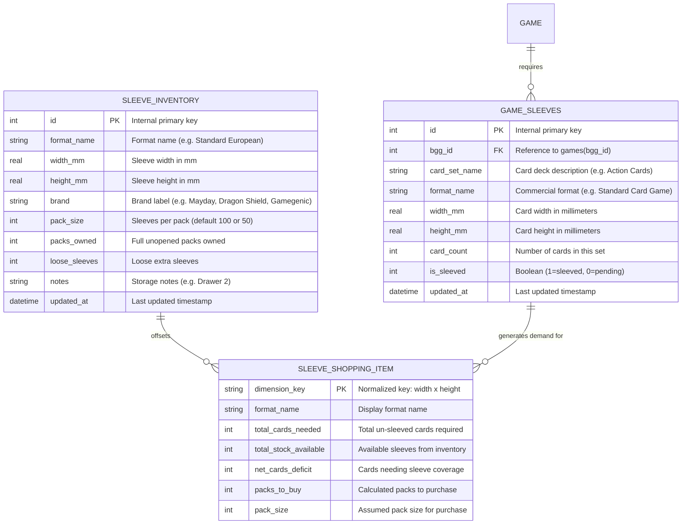

# Data Model: Card Sleeve Tracking & Inventory

**Feature**: `003-card-sleeve-manager`  
**Date**: 2026-11-14  
**Status**: Completed  

---

## 1. Entity-Relationship Overview

---

## 2. Table Definitions

### 2.1 `game_sleeves` Table
Stores sleeve requirements per game. Supports multiple card decks per title.
- `id`: `INTEGER PRIMARY KEY AUTOINCREMENT NOT NULL`.
- `bgg_id`: `INTEGER NOT NULL REFERENCES games(bgg_id) ON DELETE CASCADE`.
- `card_set_name`: `TEXT NOT NULL DEFAULT 'Main Deck'`.
- `format_name`: `TEXT NOT NULL`.
- `width_mm`: `REAL NOT NULL`. Positive float (e.g. 63.5).
- `height_mm`: `REAL NOT NULL`. Positive float (e.g. 88.0).
- `card_count`: `INTEGER NOT NULL`. Count $\ge 1$.
- `is_sleeved`: `INTEGER NOT NULL DEFAULT 0`. Boolean ($1$ if sleeved, $0$ if pending).
- `created_at`: `INTEGER NOT NULL`. Timestamp.
- `updated_at`: `INTEGER NOT NULL`. Timestamp.

### 2.2 `sleeve_inventory` Table
Stores user-owned spare sleeve stock.
- `id`: `INTEGER PRIMARY KEY AUTOINCREMENT NOT NULL`.
- `format_name`: `TEXT NOT NULL`.
- `width_mm`: `REAL NOT NULL`. Positive float.
- `height_mm`: `REAL NOT NULL`. Positive float.
- `brand`: `TEXT NOT NULL`.
- `pack_size`: `INTEGER NOT NULL DEFAULT 100`.
- `packs_owned`: `INTEGER NOT NULL DEFAULT 0`.
- `loose_sleeves`: `INTEGER NOT NULL DEFAULT 0`.
- `notes`: `TEXT`.
- `created_at`: `INTEGER NOT NULL`. Timestamp.
- `updated_at`: `INTEGER NOT NULL`. Timestamp.

