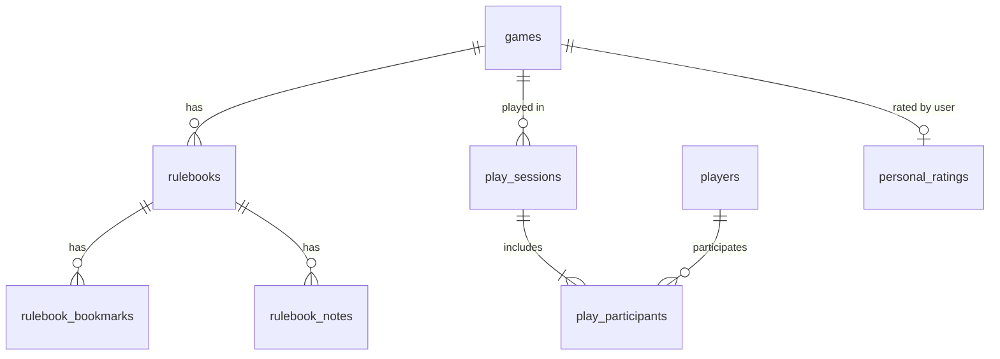
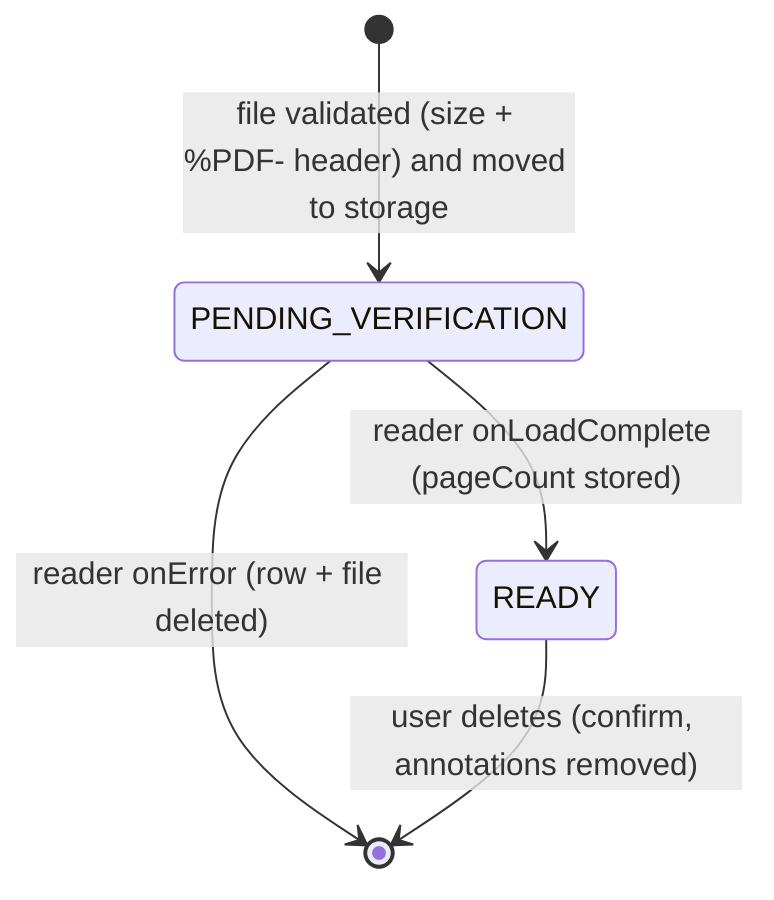

# Data Model: Offline PDF Rulebook Viewer with Annotations and Play Logging

**Feature**: `004-offline-rulebooks-playlog` | **Storage**: local SQLite (`expo-sqlite` + Drizzle ORM), files under `documentDirectory/rulebooks/`

All timestamps are epoch milliseconds (consistent with existing tables). New foreign keys to `games` use **no cascade** (see research R11).

## Entity Relationship

---

## `rulebooks`

| Column | Type | Constraints | Notes |
|--------|------|-------------|-------|
| `id` | INTEGER | PK, autoincrement | |
| `bgg_id` | INTEGER | NOT NULL, FK → `games.bgg_id` | no cascade |
| `label` | TEXT | NOT NULL, 1–120 chars | default: original file name without extension |
| `doc_type` | TEXT | NOT NULL, enum | `BASE_RULES` \| `EXPANSION` \| `QUICK_REFERENCE` \| `FAQ` \| `OTHER` |
| `source_kind` | TEXT | NOT NULL, enum | `DEVICE_FILE` \| `DOWNLOAD` |
| `source_url` | TEXT | NULL | only for `DOWNLOAD`, `https://` only |
| `relative_path` | TEXT | NOT NULL, UNIQUE | `rulebooks/{bggId}/{uuid}.pdf` (R8) |
| `file_size_bytes` | INTEGER | NOT NULL, 1 … 104 857 600 | |
| `md5` | TEXT | NOT NULL | duplicate detection (R7) |
| `page_count` | INTEGER | NULL | set on first successful render |
| `last_viewed_page` | INTEGER | NOT NULL, default 1, ≥ 1 | |
| `status` | TEXT | NOT NULL, enum | `PENDING_VERIFICATION` \| `READY` |
| `created_at` / `updated_at` | INTEGER | NOT NULL | |

Indexes: `idx_rulebooks_bgg_id (bgg_id)`, `idx_rulebooks_bgg_md5 (bgg_id, md5)`.

### State transitions

Only `READY` documents count toward the "manual disponível offline" indicator (FR-009). `PENDING_VERIFICATION` rows left by an app crash are cleaned on startup (row + file removed).

---

## `rulebook_bookmarks`

| Column | Type | Constraints |
|--------|------|-------------|
| `id` | INTEGER | PK |
| `rulebook_id` | INTEGER | NOT NULL, FK → `rulebooks.id` ON DELETE CASCADE |
| `page` | INTEGER | NOT NULL, ≥ 1 |
| `title` | TEXT | NOT NULL, 1–80 chars |
| `created_at` / `updated_at` | INTEGER | NOT NULL |

Index: `idx_bookmarks_rulebook_page (rulebook_id, page)`.

## `rulebook_notes`

| Column | Type | Constraints |
|--------|------|-------------|
| `id` | INTEGER | PK |
| `rulebook_id` | INTEGER | NOT NULL, FK → `rulebooks.id` ON DELETE CASCADE |
| `page` | INTEGER | NOT NULL, ≥ 1 |
| `body` | TEXT | NOT NULL, 1–2000 chars |
| `created_at` / `updated_at` | INTEGER | NOT NULL |

Index: `idx_notes_rulebook_page (rulebook_id, page)`.

Annotation validation: `page ≥ 1`. When `page > rulebooks.page_count`, the annotation is kept and returned with `isPageAvailable = false` (edge case).

> SQLite only enforces `ON DELETE CASCADE` with `PRAGMA foreign_keys = ON`; the repository additionally deletes annotations explicitly inside the rulebook-deletion transaction.

---

## `players`

| Column | Type | Constraints |
|--------|------|-------------|
| `id` | INTEGER | PK |
| `name` | TEXT | NOT NULL, 1–40 chars, UNIQUE (case-insensitive, `COLLATE NOCASE`) |
| `is_hidden` | INTEGER | NOT NULL, default 0 |
| `created_at` / `updated_at` | INTEGER | NOT NULL |

Hard delete allowed only with zero `play_participants` rows (R13).

## `play_sessions`

| Column | Type | Constraints |
|--------|------|-------------|
| `id` | INTEGER | PK |
| `bgg_id` | INTEGER | NOT NULL, FK → `games.bgg_id` (no cascade) |
| `played_on` | TEXT | NOT NULL, ISO date `YYYY-MM-DD`, not after today (local time) |
| `duration_minutes` | INTEGER | NULL, 1–1440 |
| `outcome` | TEXT | NOT NULL, enum `COMPETITIVE` \| `COOP_WIN` \| `COOP_LOSS` |
| `comments` | TEXT | NULL, ≤ 2000 chars |
| `created_at` / `updated_at` | INTEGER | NOT NULL |

Indexes: `idx_sessions_bgg_date (bgg_id, played_on DESC)`.

## `play_participants`

| Column | Type | Constraints |
|--------|------|-------------|
| `id` | INTEGER | PK |
| `session_id` | INTEGER | NOT NULL, FK → `play_sessions.id` ON DELETE CASCADE |
| `player_id` | INTEGER | NOT NULL, FK → `players.id` |
| `score` | REAL | NULL; must be NULL for cooperative outcomes |
| `is_winner` | INTEGER | NOT NULL, default 0; must be 0 for cooperative outcomes |

Constraints: UNIQUE `(session_id, player_id)`; ≥ 1 participant per session (service-enforced). Index: `idx_participants_player (player_id)`.

## `personal_ratings`

| Column | Type | Constraints |
|--------|------|-------------|
| `bgg_id` | INTEGER | PK, FK → `games.bgg_id` (no cascade) |
| `rating` | INTEGER | NOT NULL, 1–10 |
| `updated_at` | INTEGER | NOT NULL |

Clearing a rating deletes the row. Never touched by `CollectionSyncService` (FR-020).

---

## Derived value: `PlayStats` (not persisted)

Computed by `computePlayStats(sessions)`:

| Field | Rule |
|-------|------|
| `totalPlays` | count of sessions |
| `lastPlayedOn` | max `played_on`, or `null` |
| `averageDurationMinutes` | mean of non-null durations, rounded to integer; `null` if none |
| `winsByPlayer` | per player: count of sessions where `is_winner = 1` (ties count once for each winner) |
| `coopRecord` | `{ wins, losses }` across cooperative sessions |

