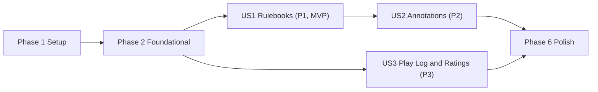

# Tasks: Offline PDF Rulebook Viewer with Annotations and Play Logging

**Input**: Design documents from `specs/004-offline-rulebooks-playlog/` (`plan.md`, `spec.md`, `research.md`, `data-model.md`, `contracts/`, `quickstart.md`)

**Prerequisites**: `plan.md`, `spec.md`, `research.md`, `data-model.md`, `contracts/rulebook-contract.ts`, `contracts/playlog-contract.ts`, `quickstart.md`

**Tests**: Included per Constitution Principle V (TDD for file validation, rulebook/annotation services, play validation, play statistics, and rating persistence). Test tasks MUST be written first and fail before their implementation tasks.

**Organization**: Tasks are grouped by user story so each story can be implemented and tested independently.

## Format: `[ID] [P?] [Story] Description`

- **[P]**: Can run in parallel (different files, no dependencies on incomplete tasks)
- **[Story]**: User story the task belongs to (`[US1]`, `[US2]`, `[US3]`)
- Every task names its exact file path(s)

---

## Phase 1: Setup (Shared Infrastructure)

**Purpose**: New dependencies, Expo development build configuration, test mocks, and contract re-exports

- [x] T001 Run the dependency security scan for `react-native-pdf`, `react-native-blob-util`, `@config-plugins/react-native-pdf`, `@config-plugins/react-native-blob-util`, `expo-dev-client`, `expo-document-picker` and record approved versions in specs/004-offline-rulebooks-playlog/research.md (section R15)
- [x] T002 Install the approved packages with `npx expo install` (Expo SDK 52-compatible versions) updating package.json and package-lock.json
- [x] T003 Create app.json with name "VirtualStand", slug "virtualstand", scheme "virtualstand", and plugins `expo-router`, `@config-plugins/react-native-blob-util`, `@config-plugins/react-native-pdf` (research R2)
- [x] T004 [P] Create Jest mock for expo-document-picker (`getDocumentAsync` returning a configurable asset/canceled result) in tests/mocks/expo-document-picker.js and map `^expo-document-picker$` in jest.config.js
- [x] T005 [P] Extend tests/mocks/expo-file-system.js with `moveAsync`, `deleteAsync`, `readAsStringAsync`, `getFreeDiskStorageAsync`, `createDownloadResumable`, `EncodingType.Base64`, and `getInfoAsync` returning configurable `size`/`md5`
- [x] T006 [P] Re-export rulebook contracts in src/services/rulebook-types.ts (from specs/004-offline-rulebooks-playlog/contracts/rulebook-contract.ts shapes, copied as source types)
- [x] T007 [P] Re-export play log contracts in src/services/playlog-types.ts (from specs/004-offline-rulebooks-playlog/contracts/playlog-contract.ts shapes, copied as source types)

---

## Phase 2: Foundational (Blocking Prerequisites)

**Purpose**: Database schema for all seven tables (shared files `schema.ts` / `client.ts`) and startup housekeeping hook-point

**⚠️ CRITICAL**: No user story work can begin until this phase is complete

- [x] T008 Add Drizzle tables `rulebooks`, `rulebookBookmarks`, `rulebookNotes`, `players`, `playSessions`, `playParticipants`, `personalRatings` with indexes, relations, and inferred Select/Insert types in src/db/schema.ts per data-model.md (FKs to `games` WITHOUT cascade; annotations/participants cascade from parent)
- [x] T009 Add `CREATE TABLE IF NOT EXISTS` / `CREATE INDEX IF NOT EXISTS` statements for the seven tables (players.name `COLLATE NOCASE UNIQUE`, `UNIQUE(session_id, player_id)`) and `PRAGMA foreign_keys = ON` in src/db/client.ts
- [x] T010 Write schema smoke test asserting table/column names and that game FKs declare no `onDelete: 'cascade'` in tests/unit/feature004-schema.test.ts

**Checkpoint**: Schema ready — US1, US2 (after US1 repository), and US3 can proceed.

---

## Phase 3: User Story 1 - Attach and Read Rulebooks Offline (Priority: P1) 🎯 MVP

**Goal**: Attach PDFs from device or `https` link, store them locally, read offline with paging, zoom, go-to-page, and last-page resume; show offline-manual indicator in the game detail sheet (used by both collection and 3D shelf).

**Independent Test**: Quickstart Scenarios A, B, C — import `catan-rules.pdf`, enable airplane mode, relaunch, reopen on last page; invalid/locked/duplicate/offline/interrupted cases behave as specified.

### Tests for User Story 1 ⚠️ (write first, must fail)

- [x] T011 [P] [US1] Write unit tests for pure validators (`validateFileSize` 0 / 100 MB boundary, `isPdfMagicHeader` from base64 `JVBERi0=`, `validateDownloadUrl` https-only, `normalizeLabel` 1–120 chars from file name) in tests/unit/rulebook-validation.test.ts
- [x] T012 [P] [US1] Write service tests with mocked repository and file service covering: import from device success → `PENDING_VERIFICATION`; `NOT_A_PDF`, `FILE_TOO_LARGE`, `EMPTY_FILE`, `INSUFFICIENT_STORAGE`; `DUPLICATE` (same bggId+md5) and `allowDuplicate`; `importFromUrl` `OFFLINE`/`INVALID_URL`/`CANCELLED`/`DOWNLOAD_FAILED` with temp file removed; `markVerified` stores pageCount; `rejectUnreadable` deletes row+file; `cleanupPending`; relative path stored and resolved to absolute `fileUri` in tests/unit/rulebook-service.test.ts

### Implementation for User Story 1

- [x] T013 [P] [US1] Implement pure validators `validateFileSize`, `isPdfMagicHeader`, `validateDownloadUrl`, `normalizeLabel`, `MAX_RULEBOOK_SIZE_BYTES` in src/services/rulebook-validation.ts
- [x] T014 [P] [US1] Implement RulebookRepository (insert, listByBggId, findById, findByBggIdAndMd5, updateStatus/pageCount, updateLastViewedPage, rename, listPending, delete in transaction incl. bookmarks/notes, countAnnotations) in src/db/repositories/rulebook.repository.ts
- [x] T015 [US1] Implement RulebookFileService wrapping native APIs: `pickPdf()` (expo-document-picker), `inspect(uri)` (size + md5 via getInfoAsync), `readHeader(uri)` (first 5 bytes base64), `hasFreeSpace(bytes)`, `persist(tempUri, bggId)` → relative path `rulebooks/{bggId}/{uuid}.pdf`, `toAbsoluteUri(relative)`, `startDownload(url, onProgress)` → `{ promise, cancel }` into `cacheDirectory/rulebook-downloads/`, `remove(relativeOrTemp)` in src/services/rulebook-file.service.ts
- [x] T016 [US1] Implement RulebookService (IRulebookService: listByGame, hasReadyRulebook, importFromDevice, importFromUrl with network check via src/services/network.service.ts, markVerified, rejectUnreadable, rename, countAnnotations, delete, saveLastViewedPage, cleanupPending) with dependency-injected repository/file service in src/services/rulebook.service.ts
- [x] T017 [US1] Implement `useRulebooks(bggId)` hook (list, import from device/url with progress + cancel, duplicate prompt state, rename, delete, refresh) in src/hooks/use-rulebooks.ts
- [x] T018 [P] [US1] Implement PdfReader component wrapping `react-native-pdf` (local `fileUri`, `page` prop, `enablePaging`, min/max scale, page indicator "x / N", "Ir para página" input, `onLoadComplete` → markVerified when pending, `onError` → rejectUnreadable + alert, debounced 500 ms last-page save + flush on unmount and AppState background) in src/components/rulebooks/pdf-reader.tsx
- [x] T019 [US1] Create full-screen reader route loading the rulebook by id and rendering PdfReader (header with label; "not available on web" guard via `Platform.OS`) in app/rulebook/[id].tsx and register the stack screen in app/_layout.tsx
- [x] T020 [P] [US1] Implement RulebookImportSheet (options "Adicionar do aparelho" / "Adicionar por link", URL input, label + doc type selector, download progress bar with cancel, duplicate confirmation "Pular" / "Importar mesmo assim", error messages per `RulebookImportErrorCode`) in src/components/rulebooks/rulebook-import-sheet.tsx
- [x] T021 [US1] Implement RulebookList ("Manuais" section: label, doc type, page count, size in MB; tap → `router.push('/rulebook/[id]')`; rename; delete with confirmation showing annotation count; add button opening import sheet; web fallback message "Leitura de manuais disponível no app iOS/Android") in src/components/rulebooks/rulebook-list.tsx; navigate to the reader right after a successful import
- [x] T022 [US1] Integrate RulebookList section and an "📖 Manual offline" badge (when `hasReadyRulebook`) into src/components/game-detail-sheet.tsx (covers the 3D shelf inspector, which reuses this sheet in app/(tabs)/shelf.tsx)
- [x] T023 [US1] Call `rulebookService.cleanupPending()` after `initializeTables()` during startup in app/_layout.tsx (non-blocking, errors logged)

**Checkpoint**: MVP complete — rulebooks attach, verify, and read fully offline.

---

## Phase 4: User Story 2 - Bookmarks and Page Notes on Rulebooks (Priority: P2)

**Goal**: Titled bookmarks and free-text page notes, annotations panel with tap-to-navigate, and in-reader indicators.

**Independent Test**: Quickstart Scenario D — bookmark page 7, note on page 3, reopen, jump via panel, edit/delete, delete rulebook shows correct annotation count.

**Depends on**: US1 (RulebookRepository, PdfReader, reader route)

### Tests for User Story 2 ⚠️ (write first, must fail)

- [x] T024 [P] [US2] Write AnnotationService tests (add/update/delete bookmark title 1–80 chars, note body 1–2000 chars, page ≥ 1 validation, lists ordered by page, `isPageAvailable = false` when page > pageCount, `annotatedPages` sets) with mocked repository in tests/unit/annotation-service.test.ts

### Implementation for User Story 2

- [x] T025 [US2] Add bookmark/note CRUD queries (listBookmarks, insertBookmark, updateBookmark, deleteBookmark, listNotes, insertNote, updateNote, deleteNote ordered by page) to src/db/repositories/rulebook.repository.ts
- [x] T026 [US2] Implement AnnotationService (IAnnotationService) with validation and `isPageAvailable` computed from rulebook pageCount in src/services/annotation.service.ts
- [x] T027 [US2] Implement `useAnnotations(rulebookId)` hook (bookmarks, notes, annotated page sets, CRUD actions, refresh) in src/hooks/use-annotations.ts
- [x] T028 [P] [US2] Implement AnnotationsPanel (side/bottom panel listing bookmarks and notes ordered by page, "página indisponível" flag, tap → `onNavigate(page)`, inline edit/delete with confirmation, add bookmark/note for current page) in src/components/rulebooks/annotations-panel.tsx
- [x] T029 [US2] Integrate annotations into PdfReader: toolbar buttons "Adicionar marcador" / "Adicionar nota" for current page, bookmark/note indicators when current page is annotated, panel toggle and navigation in src/components/rulebooks/pdf-reader.tsx

**Checkpoint**: US1 + US2 functional — rulebooks become personalized references.

---

## Phase 5: User Story 3 - Play Session Logging and Personal Ratings (Priority: P3)

**Goal**: Log play sessions with reusable players, competitive/cooperative outcomes, computed statistics, and a personal 1–10 rating independent of BGG.

**Independent Test**: Quickstart Scenarios E, F — two sessions with tie → "2 partidas", avg 75 min, wins Ana 2 / Bruno 1 / Carla 0; co-op record; rating 8 survives sync; player in use can only be hidden.

**Depends on**: Foundational only (independent of US1/US2)

### Tests for User Story 3 ⚠️ (write first, must fail)

- [x] T030 [P] [US3] Write tests for pure `computePlayStats` (empty input, totals, lastPlayedOn, average over non-null durations rounded, ties counted for each winner, plays per player, coop record, sort order) in tests/unit/play-stats.test.ts
- [x] T031 [P] [US3] Write tests for `validatePlaySession` (FUTURE_DATE vs today local, INVALID_DATE, NO_PARTICIPANTS, DUPLICATE_PARTICIPANT, INVALID_DURATION outside 1–1440, COOP_WITH_SCORES incl. winners on co-op, INVALID_SCORE non-finite) in tests/unit/play-validation.test.ts
- [x] T032 [P] [US3] Write tests for PersonalRatingService (accepts integers 1–10, rejects 0/11/7.5, null clears) and PlayerService rules (NAME_TAKEN case-insensitive, INVALID_NAME, PLAYER_IN_USE on delete with participations, setHidden) with mocked repositories in tests/unit/personal-rating.test.ts and tests/unit/player-service.test.ts

### Implementation for User Story 3

- [x] T033 [P] [US3] Implement pure `computePlayStats` in src/services/play-stats.ts
- [x] T034 [P] [US3] Implement zod schemas and `validatePlaySession(input, today)` returning `Result` codes in src/services/play-validation.ts
- [x] T035 [P] [US3] Implement PlayLogRepository (players CRUD + participation count, sessions with participants insert/update/delete in transactions, listSessionsByBggId newest first with player names) in src/db/repositories/play-log.repository.ts
- [x] T036 [P] [US3] Implement PersonalRatingRepository (get, upsert, delete by bggId) in src/db/repositories/personal-rating.repository.ts
- [x] T037 [US3] Implement PlayLogService (IPlayLogService + IPlayerService using validatePlaySession and computePlayStats) in src/services/play-log.service.ts
- [x] T038 [US3] Implement PersonalRatingService (IPersonalRatingService) in src/services/personal-rating.service.ts
- [x] T039 [US3] Implement `usePlayLog(bggId)` hook (sessions, stats, players, rating, log/update/delete session, player create/rename/hide/delete, setRating, refresh) in src/hooks/use-play-log.ts
- [x] T040 [P] [US3] Implement PlayerPicker (quick-select chips for visible players, inline "Novo jogador", hide/rename via long press, PLAYER_IN_USE → offer "Ocultar") in src/components/playlog/player-picker.tsx
- [x] T041 [P] [US3] Implement PlaySessionForm (date picker defaulting to today, duration, outcome selector Competitivo / Vitória do grupo / Derrota do grupo, per-participant score + winner toggles hidden for co-op, comments, validation error messages, create and edit modes) in src/components/playlog/play-session-form.tsx
- [x] T042 [P] [US3] Implement PlayStatsCard (total plays, last played pt-BR date, average duration, wins per player, co-op record) in src/components/playlog/play-stats-card.tsx
- [x] T043 [P] [US3] Implement PlayHistory (sessions newest first with date, outcome, participants/scores/winners; edit opens form; delete with confirmation) in src/components/playlog/play-history.tsx
- [x] T044 [P] [US3] Implement PersonalRatingInput (1–10 selector with clear action) in src/components/personal-rating-input.tsx
- [x] T045 [US3] Integrate "Nota pessoal" next to (not replacing) the BGG rating and a "Partidas" section (PlayStatsCard, "Registrar partida" button opening PlaySessionForm modal, PlayHistory) into src/components/game-detail-sheet.tsx
- [x] T046 [US3] Write regression test asserting `CollectionSyncService.synchronize` never calls play-log, rating, or rulebook repositories (data preserved across sync, FR-020) in tests/unit/feature004-sync-preservation.test.ts

**Checkpoint**: All user stories complete and independently testable.

---

## Phase 6: Polish & Cross-Cutting Concerns

**Purpose**: Verification, documentation, and performance/offline validation

- [x] T047 [P] Update README.md with development build instructions (`npx expo prebuild --clean`, `npx expo run:android|ios`) and the web limitation for rulebooks
- [x] T048 [P] Verify no untyped `any` (tests excluded only where mocks require casting) via `grep -rn ": any\|as any" src app` and fix occurrences in new files under src/services, src/hooks, src/components/rulebooks, src/components/playlog
- [x] T049 Run `npm run typecheck && npm test` and fix failures across the codebase
- [x] T050 Execute quickstart Scenarios A–G on a development build and record outcomes in specs/004-offline-rulebooks-playlog/quickstart.md (Validation Log section)

---

## Dependencies & Execution Order

### Phase Dependencies

- **Setup (Phase 1)**: No dependencies. T002 depends on T001; T003 depends on T002.
- **Foundational (Phase 2)**: Depends on Setup (types). BLOCKS all user stories. T009/T010 depend on T008.
- **US1 (Phase 3)**: Depends on Foundational. MVP.
- **US2 (Phase 4)**: Depends on US1 (repository file, reader component, route).
- **US3 (Phase 5)**: Depends on Foundational only — can run in parallel with US1/US2 by a separate developer. T045 touches `game-detail-sheet.tsx`, so sequence it after T022.
- **Polish (Phase 6)**: Depends on all desired stories.

### Within Each Story

- Tests → pure functions → repositories → services → hooks → components → integration.
- US1: T011/T012 → T013, T014 → T015 → T016 → T017 → T018, T020 → T019, T021 → T022 → T023
- US2: T024 → T025 → T026 → T027 → T028 → T029
- US3: T030–T032 → T033–T036 → T037, T038 → T039 → T040–T044 → T045 → T046

### Story Dependency Graph



---

## Parallel Opportunities

```bash
# Phase 1
Task T004: expo-document-picker mock in tests/mocks/expo-document-picker.js
Task T005: extend tests/mocks/expo-file-system.js
Task T006: src/services/rulebook-types.ts
Task T007: src/services/playlog-types.ts

# US1 tests, then foundations
Task T011: tests/unit/rulebook-validation.test.ts
Task T012: tests/unit/rulebook-service.test.ts
Task T013: src/services/rulebook-validation.ts
Task T014: src/db/repositories/rulebook.repository.ts

# US1 UI
Task T018: src/components/rulebooks/pdf-reader.tsx
Task T020: src/components/rulebooks/rulebook-import-sheet.tsx

# US3 (can run alongside US1/US2)
Task T030: tests/unit/play-stats.test.ts
Task T031: tests/unit/play-validation.test.ts
Task T032: tests/unit/personal-rating.test.ts + tests/unit/player-service.test.ts
Task T033: src/services/play-stats.ts
Task T034: src/services/play-validation.ts
Task T035: src/db/repositories/play-log.repository.ts
Task T036: src/db/repositories/personal-rating.repository.ts
Task T040–T044: playlog components and rating input
```

---

## Implementation Strategy

### MVP First (User Story 1 Only)

1. Phase 1 Setup (T001–T007) — includes dependency scan and dev build config.
2. Phase 2 Foundational (T008–T010).
3. Phase 3 US1 (T011–T023).
4. **STOP and VALIDATE**: Quickstart Scenarios A–C on a development build, offline.

### Incremental Delivery

1. **Increment 1**: Setup + Foundational + US1 → offline rulebooks.
2. **Increment 2**: US2 → bookmarks and notes.
3. **Increment 3**: US3 → play log, stats, personal rating (may be delivered before US2 if preferred).
4. **Increment 4**: Polish → docs, typecheck/tests, quickstart validation log.

### Parallel Team Strategy

- Developer A: US1 → US2 (rulebook track).
- Developer B: US3 (play log track), coordinating only on `game-detail-sheet.tsx` integration (T022 before T045).

