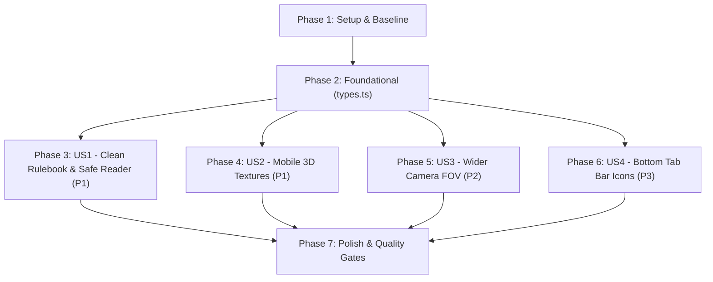

# Tasks: Mobile UX & 3D Shelf Audit Fixes

**Input**: Design documents from `specs/014-mobile-ux-shelf-fixes/`  
**Prerequisites**: plan.md (required), spec.md (required), research.md, data-model.md, contracts/  
**Organization**: Tasks are grouped by user story (P1 -> P2 -> P3) to enable independent implementation and testing.

## Format: `[ID] [P?] [Story] Description`

- **[P]**: Can run in parallel (different files, no dependencies)
- **[Story]**: Which user story this task belongs to (US1, US2, US3, US4)
- Include exact file paths in descriptions

---

## Phase 1: Setup & Contracts Verification

**Purpose**: Verify contracts and workspace state before implementing user stories.

- [x] T001 Verify interface contracts in `specs/014-mobile-ux-shelf-fixes/contracts/aisle-camera-pose.contract.ts` and `specs/014-mobile-ux-shelf-fixes/contracts/rulebook-interaction.contract.ts`
- [x] T002 [P] Confirm test suite baseline passes with `npm test` and `npm run typecheck`

---

## Phase 2: Foundational Prerequisites

**Purpose**: Core camera pose interface updates required by 3D shelf navigation.

- [x] T003 Update `AisleCameraPose` interface in `src/components/shelf-3d/types.ts` to include `fov: number` property matching `specs/014-mobile-ux-shelf-fixes/contracts/aisle-camera-pose.contract.ts`

**Checkpoint**: Foundational contracts ready — user story implementation can begin.

---

## Phase 3: User Story 1 - Clean & Safe One-Click Rulebook Opening in Game Details (Priority: P1) 🎯 MVP

**Goal**: Remove modal clutter (`+ Anexar PDF`, `Ludopedia`, `Ler/Renomear/Excluir`), open rulebook on single card tap, dismiss details modal before navigating, and provide a prominent back button and resilient viewer so users never get trapped in a frozen screen.

**Independent Test**: Open game details modal for any game, verify all attach/Ludopedia/action buttons are gone, tap directly on a rulebook card, verify modal dismisses cleanly, the rulebook reader opens without freezing, and tapping the header back button returns immediately to the collection screen.

### Tests for User Story 1

- [x] T004 [P] [US1] Create unit tests for simplified rulebook interaction and card tap in `tests/unit/rulebook-interaction.test.ts`

### Implementation for User Story 1

- [x] T005 [US1] Strip "+ Anexar PDF", "🔍 Ludopedia", "+ Anexar Arquivo PDF (PT-BR)", and the inline action links ("Ler", "Renomear", "Excluir") from `src/components/rulebooks/rulebook-list.tsx`
- [x] T006 [US1] Make tapping the rulebook item card the direct trigger to open the reader in `src/components/rulebooks/rulebook-list.tsx`
- [x] T007 [US1] Ensure `GameDetailSheet` in `src/components/game-detail-sheet.tsx` dismisses its `<Modal>` cleanly before navigating to `/rulebook/[id]`
- [x] T008 [US1] Update `app/rulebook/[id].tsx` with an explicit, touchable `headerLeft` back button calling `router.back()` and resilient error fallback controls
- [x] T009 [US1] Provide a resilient document viewing and sharing fallback in `src/components/rulebooks/pdf-reader.tsx` for mobile Expo Go environments

**Checkpoint**: User Story 1 fully functional and testable independently.

---

## Phase 4: User Story 2 - Render Authentic 3D Box Covers and Textures on Mobile (Priority: P1)

**Goal**: Enable authentic cover art and procedural spine textures to load safely on physical mobile devices without failing due to DOM `document.createElement` assumptions.

**Independent Test**: Navigate to 3D shelf on mobile, verify that boxes display their cover images and high-contrast spines instead of blank solid color meshes.

### Tests for User Story 2

- [x] T010 [P] [US2] Update unit tests in `tests/unit/spine-generator.test.ts` to verify non-DOM cross-platform spine and cover texture resolution
- [x] T011 [US2] Make `SpineGeneratorService` in `src/services/spine-generator.service.ts` cross-platform, eliminating DOM `document` crashes on React Native
- [x] T012 [US2] Update `GameBoxMesh` in `src/components/shelf-3d/game-box-mesh.tsx` with mobile-safe texture loading and high-contrast procedural box materials

**Checkpoint**: User Story 2 functional — 3D shelf renders authentic boxes on mobile.

---

## Phase 5: User Story 3 - Wider Field of View (FOV) on Lateral Shelf Camera Focus (Priority: P2)

**Goal**: Adjust camera rig with increased step-back distance (1.05), diagonal yaw angle (0.92 rad), and dynamic FOV (70° on lateral focus, 54° on center) so users can view a wide span of the bookcase comfortably without claustrophobic over-zoom.

**Independent Test**: Tap LEFT or RIGHT in 3D shelf, verify camera transitions to FOV 70° with 1.05 step-back distance showing multiple adjacent cubbies, and tap CENTER to verify smooth return to FOV 54°.

### Tests for User Story 3

- [x] T013 [P] [US3] Update unit tests in `tests/unit/aisle-shelf-navigation.test.ts` to assert `fov` property, updated `SIDE_LATERAL_STEP_X`, and `SIDE_YAW_RADIANS`
- [x] T014 [US3] Update `AisleCameraController` in `src/services/aisle-camera.service.ts` with `SIDE_LATERAL_STEP_X = 1.05`, `SIDE_YAW_RADIANS = 0.92`, and dynamic `fov` in `computeCameraPose`
- [x] T015 [US3] Update `AisleCameraRig` in `src/components/shelf-3d/shelf-scene.tsx` to smoothly interpolate `camera.fov` and call `camera.updateProjectionMatrix()` on camera transitions

**Checkpoint**: User Story 3 functional — lateral shelf view is comfortable and broad.

---

## Phase 6: User Story 4 - Render Crisp Native Bottom Tab Bar Icons on Mobile (Priority: P3)

**Goal**: Provide explicit vector icons (`Ionicons`) for `collection`, `shelf`, and `settings` in the bottom tab bar, eliminating missing-glyph rectangle boxes on mobile devices.

**Independent Test**: Launch mobile app, inspect bottom navigation bar, and verify that Coleção, Estante 3D, and Configurações display clean vector icons with no rectangular placeholder boxes.

### Tests for User Story 4

- [x] T016 [P] [US4] Create unit tests in `tests/unit/mobile-tabs-navigation.test.ts` verifying tab icon options and tint bindings
- [x] T017 [US4] Update `app/(tabs)/_layout.tsx` to define `tabBarIcon` for `collection` (`library` / `library-outline`), `shelf` (`cube` / `cube-outline`), and `settings` (`settings` / `settings-outline`) using design tokens

**Checkpoint**: User Story 4 functional — tab bar icons render cleanly on mobile.

---

## Phase 7: Polish, Quality Gates & Regression Verification

**Purpose**: Verify all quality gates, type safety, and automated test suites.

- [x] T018 Run TypeScript compilation check with `npm run typecheck` (verify 0 errors)
- [x] T019 Run full automated test suite with `npm test` (verify 100% pass across all test suites)
- [x] T020 Run Impeccable UI token audit with `npm run ui:audit`
- [x] T021 Follow verification steps in `specs/014-mobile-ux-shelf-fixes/quickstart.md` on physical mobile device

---

## Dependencies & Execution Order

